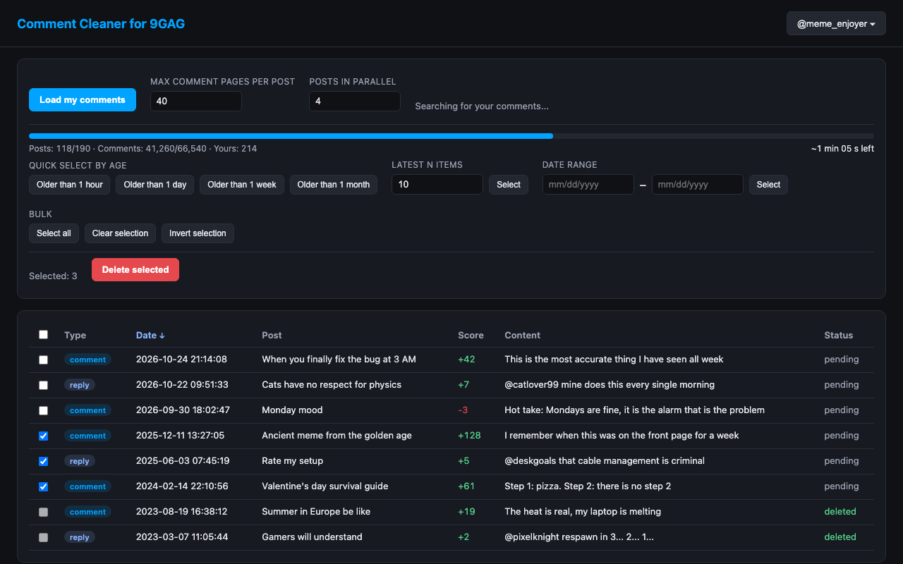

# Comment Cleaner for 9GAG


A Chrome / Brave extension (Manifest V3) that finds all your comments and replies on 9GAG, lets you
sort and select them by date, and deletes them in bulk.



- [Privacy policy](https://rakuscinec.github.io/comment-cleaner-for-9gag/privacy-policy.html)
- [Report a problem](https://github.com/rakuscinec/comment-cleaner-for-9gag/issues)

## Features

- Finds every comment and reply you wrote, including ones deep in reply threads
- Fast parallel scanning that starts as soon as the first posts arrive
- Progress bar with an estimate of the remaining time
- Quick selection: older than 1 hour / day / week / month, latest N, date range, select all, invert
- Sortable table with a link to each comment, plus a log of every action
- Optional switching between several 9GAG accounts without signing out

## How it works

- The UI runs as a standalone extension page opened in a new tab.
- In the background it keeps one quiet tab on `9gag.com` and, through it, calls the same
  undocumented API the 9GAG website itself uses, with your own sign-in:
  - `POST /v1/user-info` – username, `accountId` and the `commentAuth` token for the comment system,
  - `POST /v1/user-posts/username/<name>/type/comments` – posts you have commented on
    (the "Comments" tab on your profile),
  - `POST https://comment.9gag.com/v2/comment-list.json` – comments and reply threads under a post,
  - `POST https://comment.9gag.com/v1/comment.json` with `_method=DELETE` – deletes a comment.
- 9GAG has no list of a user's own comments, so the extension walks through every comment and
  reply under each of those posts and picks the ones with your `accountId`.
- Scanning is parallel: the list of posts is paged in the background and scanning starts with the
  first posts right away. Several posts are scanned at once ("Posts in parallel", 4 by default) and
  reply threads within a post are fetched 4 at a time. Requests answered with 429 / 5xx are retried
  with a back-off.
- "Max comment pages per post" (1 page ≈ 50 top-level comments; reply threads are always read in
  full) caps the time spent on posts with thousands of comments. The log tells you which posts were
  only partially scanned. You can stop loading at any time — comments found so far stay in the table.
- The progress bar weights posts by their comment count and estimates the remaining time from the
  speed so far. While the list of posts is still loading, the estimate is a lower bound ("At least").
- When the extension opens, it checks right away whether you are signed in to 9GAG and shows the
  account in the top right.
- **No overwriting.** 9GAG does not allow editing comments, so they are deleted directly. A comment
  that has replies is shown by 9GAG as "deleted" (other people's replies remain).

## Multiple accounts

Cookies for `9gag.com` are saved to `chrome.storage.local` when you add an account and swapped
when you switch.

1. Account button (top right) → "+ Sign in to a new account".
2. Sign in in the new `9gag.com/login` tab (you enter your password directly on 9gag.com). The
   extension detects the sign-in (checks every 2 s), closes the tab and saves the account.
3. Switching accounts changes the 9GAG sign-in for the **whole browser** (that profile).

## Installation from source (Chrome and Brave)

1. Clone or download this repository.
2. Open `chrome://extensions` (or `brave://extensions`).
3. Turn on "Developer mode".
4. Click "Load unpacked" → select the `extension` folder.
5. Click the extension icon – a new tab with the app opens.

## Repository layout

| Path | Contents |
|---|---|
| `extension/` | The extension itself – this is what gets packaged |
| `docs/` | GitHub Pages site (project page and privacy policy) |
| `store/` | Chrome Web Store listing texts, screenshot and promo tile |
| `assets/` | Source SVG of the icon |
| `scripts/build.sh` | Builds `dist/comment-cleaner-for-9gag-<version>.zip` for the Web Store |

To build the Web Store package:

```bash
./scripts/build.sh
```

## Important notes

- **Irreversible.** Deleted comments cannot be restored.
- Try it first on 1–2 old comments and check on 9gag.com that they are really gone.
- There is a ~1 s pause between deletions because of rate limits.
- This uses an unofficial API; 9GAG may change it at any time.
- Saved cookies contain sign-in session tokens – they are stored only locally in this browser and
  are never sent anywhere other than 9gag.com.

This project is not affiliated with, endorsed by or sponsored by 9GAG.

## License

[MIT](LICENSE)
